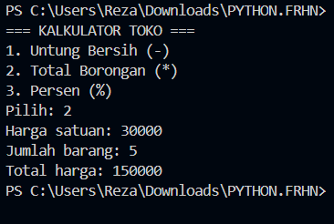

# project-kalkulator-uts-farhan

Project Ujian Tengah Semester (UTS) mata pelajaran Pemrograman Dasar / Koding & Kecerdasan Artifisial kelas X PPLG. Aplikasi ini dibuat dalam dua versi bahasa pemrograman, yaitu **C** dan **Python**.

## Identitas Siswa
* **Nama Lengkap:** [Muhammad Farhan Ibrahim]
* **Kelas:** X PPLG
* **No. Absen:** [23]

## Deskripsi Aplikasi
[aplikasi ini sangat membantu kalian untuk menghitung angka besar maupun kecil,biasanya digunakan di dunia bisnis.]

## Daftar File
* `kalkulator.c` : Kode program utama menggunakan bahasa C.
* `profict calulator.py` : Kode program utama menggunakan bahasa Python.
* `output kalkulator farhan.png` : Screenshot hasil menjalankan program Python.

## Screenshot Output Program

